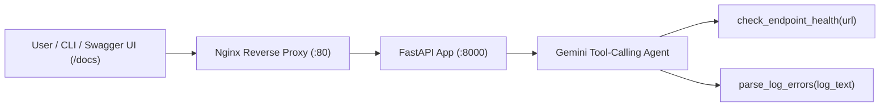

# CloudOps-Agent

**Agentic AI Log Triage & Service Health Monitor** built with Python, FastAPI, Google Gemini (`google-genai`), and Docker + Nginx.

## Architecture



## Project Structure

```text
CloudOps-Agent/
├── app/
│   ├── __init__.py          # Package version
│   ├── agent.py             # Gemini Interactions API tool-calling loop with fallback
│   ├── cli.py               # Terminal CLI interface
│   ├── config.py            # Pydantic environment settings
│   ├── main.py              # FastAPI routes (/health, /triage, /docs)
│   └── tools.py             # Endpoint health check & log error parser tools
├── nginx/default.conf       # Reverse proxy config for port 80 -> :8000
├── tests/                   # Pytest unit tests with mocked Gemini & HTTP clients
├── Dockerfile               # Multi-stage python:3.12-slim non-root image
├── docker-compose.yml       # Runs cloudops-agent + nginx locally
├── pyproject.toml           # Ruff & Pytest configuration
├── requirements.txt         # Runtime dependencies
└── requirements-dev.txt     # Development & test dependencies
```

## Quick Start (Local Python)

1. **Create a virtual environment and install dependencies:**
   ```powershell
   python -m venv .venv
   .venv\Scripts\Activate.ps1
   pip install -r requirements-dev.txt
   ```
   *(On Linux/macOS, activate with `source .venv/bin/activate`.)*

2. **Configure environment variables:**
   ```powershell
   Copy-Item .env.example .env
   ```
   Set `GEMINI_API_KEY` in `.env` (never commit `.env` or real keys).

3. **Run the API server:**
   ```powershell
   uvicorn app.main:app --reload
   ```
   Open `http://127.0.0.1:8000/docs` to test `/health` and `/triage` in Swagger UI.

4. **Or run via CLI:**
   ```powershell
   python -m app.cli --url http://127.0.0.1:8000/health --question "Verify service health"
   python -m app.cli --log-file path\to\app.log --json
   ```

## Run with Docker Compose

```powershell
docker compose up -d --build
```
Check `http://localhost/health` and `http://localhost/docs` through Nginx. Stop with `docker compose down`.

## Linter & Tests

All unit tests mock Gemini and HTTP calls (no API key required):

```powershell
ruff check .
pytest -v
```
